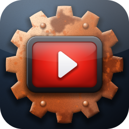

# TubeMini



Xem YouTube trên iPad mini 1 (iOS 6, đã jailbreak), gồm hai phần:

- **`server/` — tubemini-server** (Rust): chạy trên PC Windows trong nhà. Giả lập API GData cũ để app YouTube cũ cùng tweak
  TubeRepair dùng lại được, và có thêm API `/tm/v1` cho app TubeMini. Server chỉ trả XML và link video; video thì iPad tải
  thẳng từ Google.
- **`ios/TubeMini/` — app TubeMini** (Objective-C, Theos, armv7, iOS 6.0): app YouTube mới, giao diện tiếng Việt. Có tìm kiếm,
  phát 360p / 720p / 1080p, theo dõi kênh (feed trang chủ), lịch sử và xem tiếp, trang kênh, giao diện sáng / tối, chỉ nghe
  (phát nền, thanh nghe nhạc thu nhỏ), tải về 360p / 720p / 1080p để xem offline.
  Kênh theo dõi và lịch sử lưu trên server (SQLite).

Tài liệu:

| File | Nội dung |
| --- | --- |
| [docs/SETUP.md](docs/SETUP.md) | Cài server, cài bộ build app, cài lên iPad, kiểm thử qua SSH |
| [docs/API.md](docs/API.md) | Hợp đồng API giữa server và app |
| [docs/DECISIONS.md](docs/DECISIONS.md) | Các quyết định kỹ thuật và kết quả kiểm chứng |
| [docs/PROGRESS.md](docs/PROGRESS.md) | Tiến độ từng giai đoạn |
| [tubemini-prompt.md](tubemini-prompt.md) | Mô tả dự án gốc |

## Chạy nhanh server

```powershell
winget install DenoLand.Deno            # yt-dlp cần Deno; mở terminal mới sau khi cài
yt-dlp -U                               # luôn dùng yt-dlp mới nhất
cd server
cargo build --release
target\release\tubemini-server.exe      # đọc config.toml cạnh exe (mẫu: config.example.toml)
```

Mở cổng 8080 trên Windows Firewall (xem SETUP mục 1.5), rồi trên iPad vào `http://<IP PC>:8080/`.

**Ubuntu:** `sudo scripts/install.sh` (hoặc gói `dist/tubemini-server-*.tar.gz` từ `scripts/make-release.sh`) cài theo một trong
hai cách: **Docker** (container, Docker hoặc Podman) hoặc **service systemd**; tự khởi động cùng máy, tự cập nhật yt-dlp. Xem SETUP
mục 7. **Windows / macOS** có Docker Desktop: `docker compose up -d --build`. Server trong nhà hiện chạy ở `http://192.168.1.192:8080`.

## Giấy phép

GPL-3.0 — xem [LICENSE](LICENSE). Định dạng lớp GData tham khảo từ server TubeRepair
(https://github.com/kevinf100/tuberepair.uptimetrackers.com, GPL-3.0).
